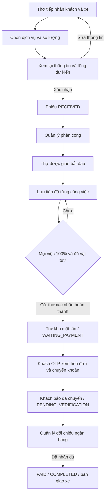

# Luồng JSP và đối chiếu repo

Ngày sửa: 21/10/2026. Nguồn: `KhoiPhanT/LT_Web`, commit `a141d3595f51beb67c05470de8f792aaee5fd4c0`. Đây là cách triển khai sát bài thực hành, không phải cam kết thay cho nhận xét trực tiếp của giảng viên.

## Cách hiểu “luồng con người” trong bản sửa

Người dùng đi theo một việc có điểm bắt đầu và kết thúc: tiếp nhận xe, giao việc, làm việc, trả tiền. Danh sách dùng để tìm phiếu; nội dung và thao tác của một xe nằm trong trang chi tiết. Thao tác đã lưu có thông báo và trang đích rõ ràng.

Trước đây, màn quản lý gom danh sách lệnh, phân công, đối soát và báo cáo; màn thợ hiển thị nhiều checklist cùng lúc. Bản mới dùng trang danh sách có tìm kiếm/lọc và trang riêng cho từng phiếu. Checkbox/chọn mức tiến độ có nhãn đầy đủ; không dùng nút xoay vòng 0 → 50 → 100 → 0 khiến người dùng phải đoán lần bấm tiếp theo.

Tiếp nhận chia nhập thông tin và xem lại. Phiếu nháp nằm trong session, tương tự giỏ hàng trong bài `cart`; người dùng xem chi phí và quay lại sửa trước khi tạo. Số tiền ở trang xem lại được đối chiếu lại từ MySQL khi xác nhận. Nếu giá hoặc định mức thay đổi, hệ thống trả 409 và yêu cầu xem lại, không tự thay tổng tiền khách vừa xem. Một session chỉ giữ một bản nháp mới nhất; mã draft riêng từ chối xác nhận trang nháp cũ ở tab khác.

Phân công đặt trong phiếu, có số việc đang nhận của mỗi thợ. Người tiếp nhận vẫn xem được phiếu mình tạo nhưng chỉ người được phân công mới bắt đầu/cập nhật/kết thúc. Khi sửa xong, khách được hướng dẫn thanh toán; báo chuyển khoản và xác nhận nhận tiền là hai thao tác của hai vai trò.

## Bài giảng đã đọc và cách áp dụng

| Tham khảo | Nội dung thực tế | Áp dụng |
| --- | --- | --- |
| `new html.zip` | Form khảo sát HTML với label, input, select, checkbox | Form rõ nhãn; không thêm framework giao diện |
| `emailFirst.zip` | `EmailListServlet` đọc tham số, tạo User, forward trang xác nhận | Form → Servlet → request/session → JSP; trả lỗi có thông báo |
| `cart.zip` | `CartServlet`, `Cart`, `LineItem`, `ProductIO`, `cart.jsp`, `checkout.jsp`; JSTL | Bản nháp trong session; nhiều dịch vụ/số lượng; xem lại chi phí trước khi ghi phiếu |
| `downloadMusic.zip` | Kiểm tra User/session, chuyển tới đăng ký rồi tiếp tục việc đang làm; ví dụ cookie | Đăng nhập/OTP theo bước và giữ thông tin biển số, điện thoại; không dùng email cookie làm bằng chứng đăng nhập |
| `sendmailC14_VNPay_Brevo_WebApp/` | Maven WAR, Jakarta Servlet, JDBC/DAO, JSP; mẫu thanh toán có bước pending và xác minh | Cấu trúc Tomcat 10.1/Jakarta, tách JSP khỏi truy vấn; phân biệt thông báo chuyển tiền và xác nhận tiền thật |

Ví dụ `emailFirst` dùng `javax.servlet`, các ví dụ mới dùng `jakarta.servlet`. Dự án thống nhất Jakarta Servlet 6/JSP/JSTL cho Tomcat 10.1; không trộn hai API. Không chép cấu hình bí mật hoặc mã thanh toán demo từ bài tham khảo vào dự án gara.

## Ánh xạ đủ vai trò và chức năng

| Chức năng gốc | Vai trò | Màn hình JSP | Controller / dữ liệu |
| --- | --- | --- | --- |
| Trang giới thiệu | Công khai | `/`, `/home` | `PageServlet` → `home.jsp` |
| Đăng nhập nhân viên bằng điện thoại/mật khẩu | Quản lý, thợ | `/login/staff` | `AuthServlet`, BCrypt, users, HttpSession |
| Gửi OTP email và xác minh | Khách | `/login/customer`, bước 1/2 và 2/2 | `AuthServlet`, `EmailService`, customers/vehicles |
| Đăng xuất | Mọi người đã đăng nhập | Menu | `AuthServlet`, hủy session |
| Tiếp nhận khách/xe và tình trạng | Thợ | `/orders/new` → `/orders/review` | `PageServlet`, `WorkOrderServlet`, customers/vehicles/work_orders |
| Một phiếu nhiều dịch vụ, số lượng, vật tư mặc định | Thợ | Form tiếp nhận và trang xem lại | `ServiceDAO`, work_order_items; giá do server tính |
| Lưu giá tại lúc tạo, hóa đơn nhiều dòng | Thợ, quản lý, khách theo quyền xem | `/orders/detail?code=...` | `OrderDAO`, work_order_items/invoices |
| Xem lệnh theo phạm vi người dùng | Ba vai trò | `/orders`, trang chi tiết | `OrderDAO`: manager toàn gara; thợ tạo/được giao; khách đúng id + biển số OTP |
| Phân công và đổi người trước khi bắt đầu | Quản lý | Khối phân công trong chi tiết | `AssignmentServlet`, `StaffDAO`, users/work_orders |
| Bắt đầu lệnh được giao | Thợ được giao | Nút “Bắt đầu sửa xe” | `ProgressServlet`, RECEIVED → IN_PROGRESS |
| Checklist 0/50/100 và phần trăm chung | Thợ cập nhật; vai trò khác xem theo quyền | Bảng công việc trong phiếu | `ProgressServlet`, work_order_items, OrderDAO |
| Hoàn thành sửa chữa khi mọi việc xong | Thợ được giao | Khối kết thúc sửa chữa | `ProgressServlet`, transaction; chuyển WAITING_PAYMENT |
| Kiểm tra tồn, trừ một lần, thiếu hàng rollback | Hệ thống khi thợ kết thúc | Báo lỗi trên thao tác và quay lại phiếu | `InventoryDAO.deductForOrder`, khóa dòng trong transaction |
| Thêm phụ tùng và điều chỉnh tồn thực tế | Quản lý | `/inventory` | `InventoryServlet`, `InventoryDAO`, parts |
| Thêm/sửa dịch vụ, giá công, vật tư, định mức; dịch vụ chỉ tiền công | Quản lý | `/services` | `ServiceServlet`, `ServiceDAO`, services/parts |
| Tra giá công, vật tư và tồn khi tiếp nhận | Thợ | Bảng chọn dịch vụ | `ServiceDAO`; quyền đọc `/api/v1/inventory` và `/services` cũ vẫn giữ |
| Hiệu suất theo khoảng ngày | Quản lý | `/reports` | `StaffDAO`, lọc thời điểm phân công, đếm đã sửa xong |
| VietQR đúng mã phiếu/số tiền | Khách đúng xe OTP | Khối thanh toán trong chi tiết | Giá snapshot của phiếu; ảnh VietQR, tài khoản MB giữ từ repo |
| Khách báo chuyển khoản | Khách đúng xe OTP | Xác nhận đã chuyển và nút báo gara | `PaymentServlet`, UNPAID → PENDING_VERIFICATION |
| Đối soát, xác nhận nhận đủ và hoàn tất phiếu | Quản lý | Xác nhận kiểm tra ngân hàng trong chi tiết | `PaymentServlet`, PAID và COMPLETED trong cùng transaction |
| API health và API cũ | Tương thích | `/api/v1/...` | Cùng Servlet và kiểm thử nghiệp vụ cũ |

Không bổ sung vai trò thu ngân/admin riêng, đặt lịch, hủy đơn, phê duyệt báo giá online hay VNPay vì repo gốc không có các chức năng này. Xem lại phiếu là bước tư vấn trực tiếp tại gara, không giả định khách đã phê duyệt trên hệ thống.

## Sơ đồ vận hành

## Cách lần theo code khi trình bày

Ví dụ sửa tiến độ: form trong `detail.jsp` gửi POST `/actions/progress/{code}/items/{id}` kèm mức và CSRF → `WebSessionFilter` kiểm tra session/CSRF → `ServletSupport` đọc `_method=PATCH` → `ProgressServlet.doPatch` kiểm tra vai trò, người được giao, trạng thái và công việc → JDBC transaction cập nhật → `WebFlow.success` redirect 303 tới phiếu → `PageServlet` gọi `OrderDAO`, forward lại JSP.

`_method=PATCH` chỉ là trường chọn thao tác cho form HTML, không làm thay đổi phương thức HTTP trên mạng. API cũ vẫn nhận PATCH thật. `WebFlow.formBody` chuyển các giá trị form vào cấu trúc dữ liệu mà controller gốc đang dùng; không gửi HTTP từ Servlet sang Servlet và không gọi API bằng JavaScript ở JSP.

Nháp tiếp nhận có mã riêng trong session; xác nhận thành công mới tiêu thụ mã. Các POST cùng session được xử lý tuần tự để tránh hai lần bấm xác nhận tạo hai phiếu. CSDL vẫn kiểm tra trạng thái và khóa dòng để bảo vệ tiến độ/thanh toán đồng thời giữa các session.

## Giới hạn giữ theo phạm vi đồ án

- Mỗi dịch vụ tối đa một loại vật tư mặc định, giống repo gốc; không phải định mức nhiều vật tư.
- Chưa có đặt cọc, thanh toán tiền mặt, hoàn tiền hoặc nút từ chối thông báo chuyển khoản.
- Quản lý xác nhận tiền và hoàn tất phiếu cùng lúc; chưa tách lưu thời điểm bàn giao vật lý.
- OTP nằm trong bộ nhớ tiến trình, restart Tomcat làm mất OTP đang chờ; email thật cần cấu hình Gmail.
- Ảnh VietQR cần Internet. Thông tin ngân hàng/số tiền/nội dung vẫn hiện bằng chữ khi ảnh không tải được.
- Tên người phụ trách trong code cũ là nhãn từ repo nguồn. Nhóm cần xác nhận phân công thực tế; bản sửa không tự gán đóng góp cho từng thành viên.
